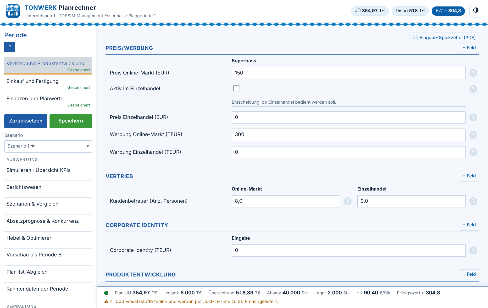
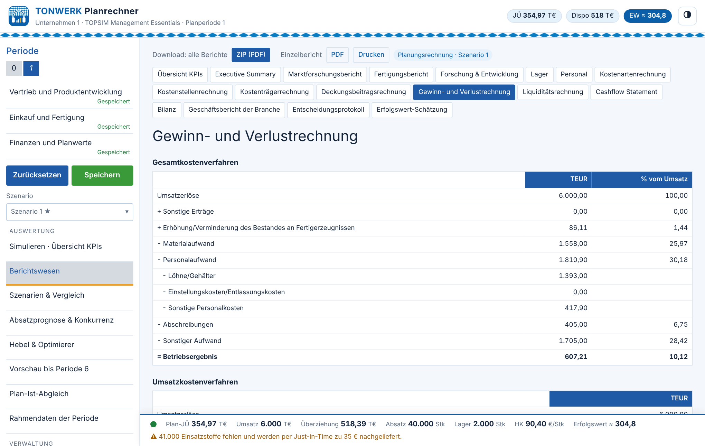
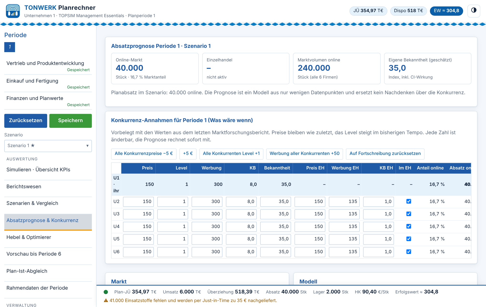
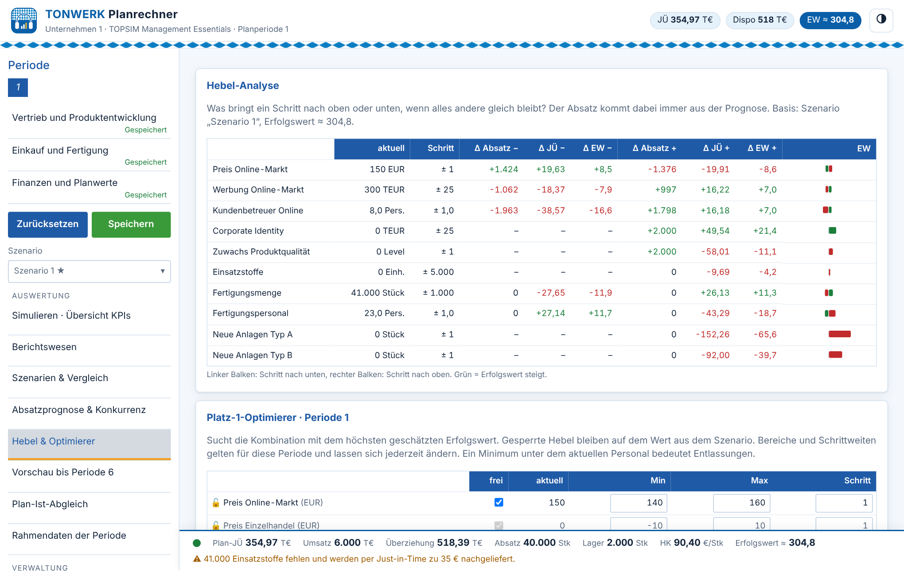
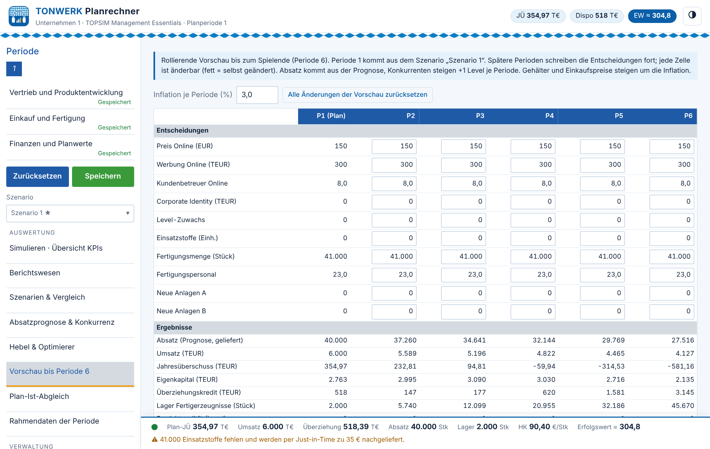
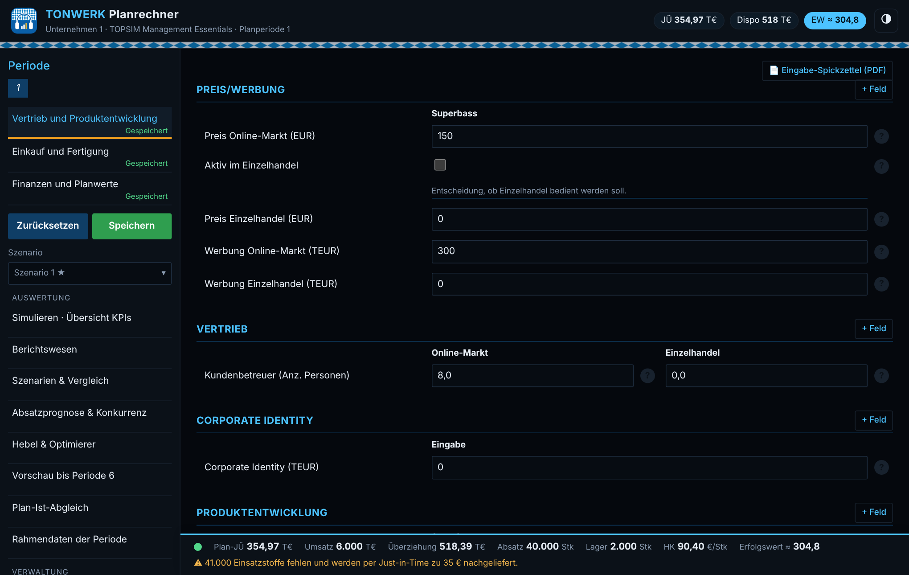
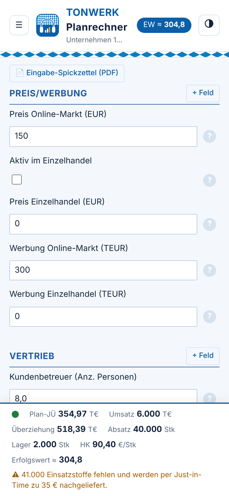

<div align="center">


# TONWERK Planrechner

**Planungsrechnung für das Planspiel TOPSIM Management Essentials: im Browser, offline und kostenlos.**

[](https://github.com/Vulnoa/Planrechner-Topsim/actions/workflows/pruefung.yml)
[](https://github.com/Vulnoa/Planrechner-Topsim/actions/workflows/codeql.yml)
[](https://github.com/Vulnoa/Planrechner-Topsim/actions/workflows/pages.yml)
[](LICENSE)

### [▶ App öffnen](https://vulnoa.github.io/Planrechner-Topsim/)

</div>

<p align="center"></p>

## Worum es geht

Im Planspiel TOPSIM kostet jede Planungsrechnung Geld aus dem Spielbudget. Der TONWERK Planrechner rechnet dieselbe Planungsrechnung kostenlos nach. Man trägt die Entscheidungen in die gleichen drei Eingabemasken wie in TOPSIM ein und bekommt alle Berichte, eine Absatzprognose und eine Schätzung des Erfolgswerts.

Die App ist von Studierenden im Rahmen einer Lehrveranstaltung entstanden. Sie startet leer mit der Ausgangslage Periode 0, die für alle Unternehmen gleich ist, und lernt mit jedem importierten TOPSIM-Bericht dazu. Sie läuft komplett im Browser, braucht kein Konto und schickt keine Daten ins Internet.

## Wie genau rechnet sie?

Der Rechenkern wurde gegen die echten TOPSIM-Berichte eines Teams geprüft. Die Daten dieses Teams sind bewusst nicht im Repository.

| Prüfung | Ergebnis |
|---|---|
| Periode 1: alle Berichte aus den Entscheidungen nachgerechnet | Abweichung 0,00 T€ |
| Periode 2: alle Berichte aus den Entscheidungen nachgerechnet | Abweichung 0,00 T€ |
| Periode 3: Vergleich mit der kostenpflichtigen TOPSIM-Planungsrechnung | Abweichung 0,00 T€ |

Öffentlich läuft bei jedem Hochladen ein [Konsistenztest](test/engine.test.mjs): Bilanz geht auf, Kasse und Überziehung stimmen, Lager und Personal folgen den Spielregeln. Wer eigene TOPSIM-Berichte hat, kann sie importieren und sieht im Berichtswesen sofort, ob die App sie auf den Cent nachrechnet („✓ nachgerechnet, stimmt mit TOPSIM überein“).

Die **Absatzprognose** und die **Erfolgswert-Schätzung** sind Modelle. TOPSIM veröffentlicht diese Formeln nicht. Die App zeigt deshalb immer an, wie gut das Modell die vergangenen Perioden getroffen hat.

## Funktionen

| Bereich | Was die App kann |
|---|---|
| **Eingabe** | Die drei Masken wie in TOPSIM (Vertrieb und Produktentwicklung, Einkauf und Fertigung, Finanzen und Planwerte). Geänderte Zeilen werden markiert, gerechnet wird beim Speichern. Optionen wie Großabnehmer oder kurzfristiger Kredit lassen sich einblenden, sobald TOPSIM sie anbietet. Eigene Eingabefelder für neue Masken lassen sich anlegen. |
| **Berichte** | Alle TOPSIM-Berichte von Kennzahlen bis Bilanz, für jede Periode. Ein Klick lädt alle als ZIP mit einzelnen PDFs herunter. |
| **Import** | TOPSIM-Sammelberichte als PDF hineinziehen. Die App liest Periode, Bilanz, Lager, Personal und Marktdaten selbst aus. |
| **Szenarien** | Beliebig viele Varianten anlegen, umbenennen und nebeneinander vergleichen. |
| **Absatzprognose** | Marktanteilsmodell, an den Marktforschungsberichten aller sechs Unternehmen kalibriert. Es lernt mit jeder importierten Periode dazu. Die Annahmen über die Konkurrenz sind frei änderbar („Was wäre, wenn …“). |
| **Hebel & Optimierer** | Zeigt, was ein Euro Preis, 25 T€ Werbung oder ein Kundenbetreuer mehr am Ergebnis ändert. Der Optimierer sucht die Kombination mit dem höchsten geschätzten Erfolgswert, jeder Hebel ist einzeln sperrbar. |
| **Vorschau** | Rechnet bis zum Spielende (Periode 6) weiter: Liquidität, Eigenkapital, Erfolgswert. |
| **Plan-Ist-Abgleich** | Vergleicht Planwerte und Prognose mit dem tatsächlichen Ergebnis jeder Periode. |
| **Spickzettel** | Eine PDF-Seite mit allen Werten in der Reihenfolge der TOPSIM-Masken, zum fehlerfreien Abtippen. |
| **Darstellung** | Bayerisches Weiß-Blau, Hell/Dunkel/Mitternacht, Deutsch oder Boarisch, für PC, Tablet und Handy. |

<table>
<tr>
<td><br><sub>Berichtswesen mit Periodenauswahl</sub></td>
<td><br><sub>Absatzprognose und Konkurrenz-Annahmen</sub></td>
</tr>
<tr>
<td><br><sub>Hebel-Analyse und Optimierer</sub></td>
<td><br><sub>Vorschau bis Periode 6</sub></td>
</tr>
<tr>
<td><br><sub>Mitternachtsmodus</sub></td>
<td align="center"><br><sub>Auf dem Handy</sub></td>
</tr>
</table>

## Benutzen

**Am schnellsten:** [vulnoa.github.io/Planrechner-Topsim](https://vulnoa.github.io/Planrechner-Topsim/) im Browser öffnen. Fertig.

**Als App installieren (optional, funktioniert dann auch offline):**

| Gerät | So geht's |
|---|---|
| Windows (Edge oder Chrome) | Seite öffnen, rechts in der Adressleiste auf das Symbol „App installieren“ klicken. |
| Android (Chrome) | Seite öffnen, Menü ⋮ → „App installieren“ bzw. „Zum Startbildschirm hinzufügen“. |
| iPhone / iPad (Safari) | Seite öffnen, Teilen-Symbol → „Zum Home-Bildschirm“. |

Es wird dabei **keine Programmdatei** installiert. Eine „installierte“ Web-App ist nur eine Verknüpfung zur Webseite, die im abgesicherten Bereich des Browsers läuft und sich jederzeit wie jede andere App wieder entfernen lässt.

**Ganz ohne Internet:** Repository als ZIP herunterladen (grüner Knopf „Code“ → „Download ZIP“), entpacken und `index.html` doppelklicken.

**Ablauf im Spiel:**
1. Entscheidungen in den drei Masken eintragen und speichern.
2. Unter „Berichtswesen“ und „Simulieren“ das Ergebnis prüfen und Szenarien vergleichen.
3. Wenn alles passt: Spickzettel drucken und die Werte in TOPSIM eintragen.
4. Nach der Auswertung den neuen Sammelbericht unter „Daten & Import“ hineinziehen. Damit beginnt die nächste Planperiode.

## Sicherheit und Datenschutz

Diese App soll man auch auf einem Dienstrechner oder im Hörsaal ohne Bedenken öffnen können. Deshalb gilt:

- **Keine Daten verlassen das Gerät.** Eingaben, Szenarien und importierte Berichte liegen nur im Speicher des eigenen Browsers. Es gibt keinen Server, kein Konto, keine Cookies, kein Tracking und keine Werbung.
- **Technisch abgesichert.** Eine Sicherheitsrichtlinie (Content Security Policy) in [`index.html`](index.html) verbietet dem Browser, irgendetwas aus dem Internet nachzuladen oder dorthin zu senden.
- **Keine Installation.** Es gibt keine `.exe`, keine Makros und keine Browser-Erweiterung. Die App ist eine normale Webseite aus HTML, CSS und JavaScript.
- **Komplett offen.** Jede Zeile Code steht in diesem Repository und kann gelesen werden ([Lizenz MIT](LICENSE)). Der Quellcode in [`js/`](js) ist kommentiert und lesbar, `js/app.bundle.js` ist nur die zusammengefasste Fassung davon.
- **Bei jedem Hochladen automatisch geprüft** ([Prüfprotokolle](https://github.com/Vulnoa/Planrechner-Topsim/actions)):
  - **Virenscan** aller Dateien mit ClamAV und aktuellen Signaturen, zusätzlich jeden Montag.
  - **Bibliotheken unverändert:** Die vier fremden Bibliotheken in [`vendor/`](vendor) werden byte-genau mit den offiziellen Paketen verglichen ([Skript](scripts/verify-vendor.sh)).
  - **Sicherheitsanalyse** des Codes mit GitHub CodeQL.
  - **Keine Internetadressen** im eigenen Code.
  - **Rechentests:** Konsistenz des Rechenkerns (Bilanz, Kasse, Lager, Personal) und Kalibrierung der Prognose.

Wer selbst nachprüfen möchte: Das ZIP des Repositorys lässt sich zusätzlich auf [virustotal.com](https://www.virustotal.com) mit rund 70 Virenscannern gleichzeitig prüfen. Mehr dazu in [SECURITY.md](SECURITY.md).

### Verwendete Bibliotheken

| Bibliothek | Version | Zweck | Lizenz |
|---|---|---|---|
| [jsPDF](https://github.com/parallax/jsPDF) | 2.5.1 | PDF-Berichte erzeugen | MIT |
| [jsPDF-AutoTable](https://github.com/simonbengtsson/jsPDF-AutoTable) | 3.8.2 | Tabellen in PDFs | MIT |
| [JSZip](https://github.com/Stuk/jszip) | 3.10.1 | ZIP mit allen Berichten | MIT |
| [PDF.js](https://github.com/mozilla/pdf.js) | 3.11.174 | TOPSIM-PDFs einlesen (Mozilla) | Apache 2.0 |

## Aufbau

```
index.html            Einstiegsseite mit Sicherheitsrichtlinie
js/engine.js          Rechenkern: Fertigung, Einkauf, Personal, Kosten, GuV, Liquidität, Bilanz
js/prognose.js        Absatzprognose (Marktanteilsmodell) und Kalibrierung
js/reports.js         Alle TOPSIM-Berichte
js/importer.js        Einlesen der TOPSIM-Sammelberichte (PDF/Text)
js/defaults.js        Ausgangslage Periode 0 (für alle Unternehmen gleich) und Parameter Periode 1
js/app.js             Oberfläche
js/app.bundle.js      Zusammengefasste Fassung von js/*.js (läuft auch per Doppelklick)
sw.js                 Offline-Speicher der App
vendor/               Fremdbibliotheken (unverändert, mit Prüfsummen)
test/                 Konsistenztest Rechenkern und Test der Prognose-Kalibrierung
```

## Mitentwickeln

```bash
npm test                # Konsistenztest Rechenkern und Prognose
npm run build           # js/app.bundle.js neu erzeugen (danach in sw.js die Cache-Version erhöhen)
npm run verify-vendor   # Bibliotheken gegen die Originale prüfen
npm start               # lokal unter http://localhost:8080 starten
```

Neue Eingabefelder, wenn TOPSIM eine neue Maske freischaltet, lassen sich direkt in der App über „+ Feld“ anlegen, ohne Programmieren.

## Rechtliches

- Lizenz: [MIT](LICENSE). Frei nutzbar, veränderbar und weitergebbar, ohne Gewähr.
- Dies ist ein **inoffizielles** Lernprojekt von Studierenden. Es steht in keiner Verbindung zur TOPSIM GmbH. „TOPSIM“ ist eine Marke ihrer Inhaberin.
- Das Repository enthält keine Originalunterlagen von TOPSIM. Die Spielregeln sind in eigenen Worten zusammengefasst. Die Startwerte in `js/defaults.js` sind die für alle Teams gleiche Ausgangslage. Daten einzelner Teams sind nicht enthalten.
- Die Ergebnisse sind eine Planungshilfe. Maßgeblich ist immer die Auswertung in TOPSIM.
